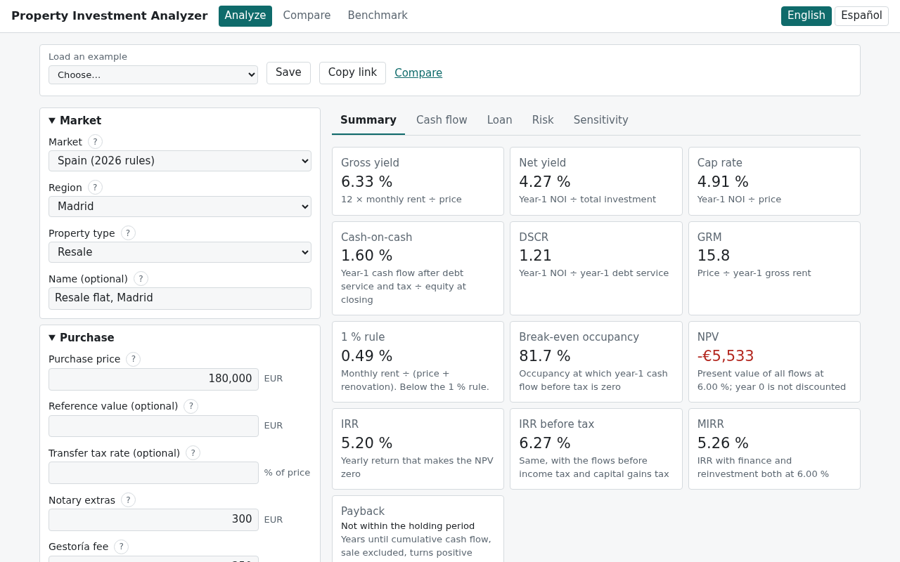
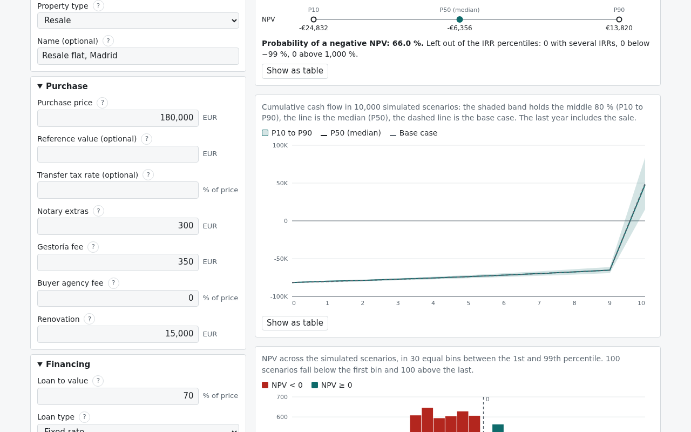
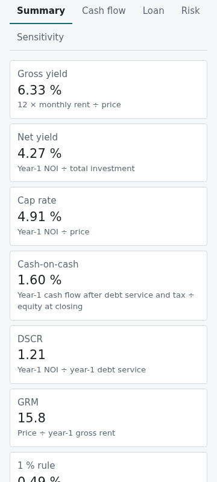
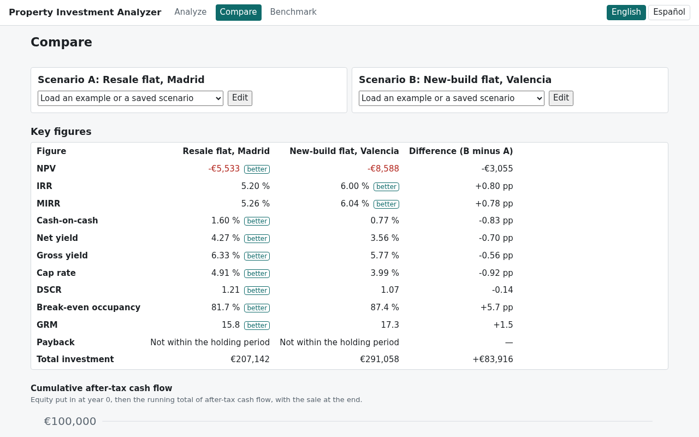

# Property Investment Analyzer

**Try it:** https://pablomedinabetancor.github.io/property-investment-analyzer/ (nothing to install; it runs in your browser).

A browser app that works out whether a rental property pays. You enter one property: the price, the purchase taxes and
costs, any renovation, the mortgage, the rent, vacancy, running costs, income tax, how long you hold it and what you sell it
for. It returns the cash flow year by year, the usual investor metrics, the loan schedule, which assumptions move the result
most, and a simulation of thousands of possible futures drawn as a band from the 10th to the 90th percentile.

It runs entirely in your browser. There is no server and no account, and nothing you type leaves the page. The calculations
are one Rust library compiled to WebAssembly; the interface is TypeScript and React. The interface is in English and Spanish.



Not financial or tax advice. Taxes are simplified and every rate can be changed; read [Limits](#limits) before relying on a
figure.

## Using it

The analysis page has the inputs on the left and the results on the right (one column on a phone). The results update as you
type and are split into five tabs:

| Tab         | What it shows                                                                                                                                                                |
| ----------- | ---------------------------------------------------------------------------------------------------------------------------------------------------------------------------- |
| Summary     | The metric cards, each with its definition and denominator, and the purchase costs and equity at closing                                                                     |
| Cash flow   | Rent, vacancy, expenses, debt service, tax and cash flow for every year, with the sale in the last year; a bar chart of the yearly cash flow and a line of the running total |
| Loan        | The amortisation schedule by year, or by month with one click                                                                                                                |
| Risk        | The simulation: the cumulative cash flow band, the IRR and NPV percentiles, the chance that NPV is negative, a histogram of NPV                                              |
| Sensitivity | A tornado chart: how far NPV moves when each assumption moves on its own                                                                                                     |

Every chart has a button that shows the same numbers as a table.



On a phone the inputs and the results stack in one column.



The toolbar loads one of four fictional examples (a resale flat in Madrid, a new-build flat in Valencia, a single-family
rental with US-style costs, a resale flat in Las Palmas), saves scenarios in your browser, copies a link that reopens the
same scenario, and opens the comparison page. The link carries the inputs themselves, so anyone you send it to sees the same
analysis; nothing is stored anywhere else.

The comparison page puts two scenarios side by side: a table of the key figures with the difference and the better side
named in words, the cumulative cash flow of both on one chart, and the NPV range of both from the simulation.



The benchmark page runs the same simulation in WebAssembly and in plain TypeScript and times both on your machine; see
[Speed](#speed).

## The metrics

| Metric               | Definition                                                                                    |
| -------------------- | --------------------------------------------------------------------------------------------- |
| Gross yield          | 12 × monthly rent ÷ price                                                                     |
| Net yield            | Year-1 net operating income (NOI) ÷ total investment (price + purchase costs + renovation)    |
| Cap rate             | Year-1 NOI ÷ price                                                                            |
| Cash-on-cash         | Year-1 cash flow after debt service (and after tax when tax is on) ÷ equity put in at closing |
| DSCR                 | Year-1 NOI ÷ year-1 debt service                                                              |
| GRM                  | Price ÷ year-1 gross rent                                                                     |
| 1 % rule             | Monthly rent ÷ (price + renovation); the rule is met at 1 % or more                           |
| Break-even occupancy | The share of the year the property must be let for year-1 cash flow before tax to be zero     |
| NPV                  | Every yearly flow discounted at your discount rate; the purchase day is not discounted        |
| IRR                  | The yearly rate at which NPV is zero, after tax and before tax                                |
| MIRR                 | The IRR with borrowing and reinvestment both at the discount rate                             |
| Payback              | Years until the running total of cash flow turns positive, without counting the sale          |

## How the numbers are computed

The full method, with every formula and its legal source, is in [docs/how-it-works.md](docs/how-it-works.md). The choices
that change a result are these:

- **Flows are yearly, at the end of each year.** The loan runs month by month inside each year. Year 0 is the day you buy:
  you put in the price, the purchase costs, the renovation and the loan fees, less the loan.
- **The sale is in the last year's flow**: the property's value grown by the appreciation rate, less the selling costs,
  the loan still owed and, with tax on, the tax on the gain.
- **NPV does not discount year 0.** Spreadsheet NPV functions discount their first value, which understates the result.
  For the flows −10,000, 3,000, 4,200 and 6,800 at 10 %, the app gives 1,307.29; Excel's `NPV()` gives 1,188.44.
- **An investment can have no IRR, or more than one.** When the flows change sign more than once there can be several
  rates that make NPV zero. The app finds each root on a grid (steps of 1 point up to 100 %, then 10 points up to 1,000 %) and says so (“several IRRs: 10.0 % and 20.0 %; see MIRR and NPV”)
  instead of showing one of them; MIRR and NPV are always shown beside it.
- **Nothing is rounded inside the engine.** Rounding happens only on screen, and table totals add the unrounded values.
- **The simulation** varies five things from year to year: the mortgage index (it drifts back towards today's value),
  rent growth, appreciation, expense growth and the number of empty months. The first four are correlated; for example,
  rents and prices tend to rise together. The volatilities and correlations are illustrative defaults that you can change.
  The random numbers come from a seeded generator, so the same seed and inputs give the same result to the last digit on
  any machine.
- **The sensitivity chart** moves one assumption at a time: price and rent by ±10 %, vacancy by ±5 points, the interest
  rate by ±1 point (the fixed rate and the index; the spread stays), appreciation by ±2 points, rent growth by ±1 point and
  operating expenses by ±20 %. A step that would take an input outside its allowed range stops at the limit, so a bar can
  be shorter on one side.

## Markets

- **Spain, by region.** A resale pays the regional transfer tax (ITP), which is a flat rate, a progressive scale or a
  rate for the whole price depending on the region. A new build pays VAT (IGIC in the Canary Islands) plus the regional
  stamp duty (AJD). Notary and registry fees follow the official scales. Transfer tax and stamp duty are charged on the
  higher of the price and the cadastral reference value when you enter one; VAT on the price. The optional income tax is the IRPF of a resident landlord, simplified.
  Rates are as of 16 October 2026.
- **Generic.** Purchase costs as a share of the price plus a fixed amount, property tax as a share of the value, and an
  optional flat income tax with straight-line depreciation and a tax on the gain at sale.
- **United States (example values).** The generic market with US-style figures: 27.5-year depreciation of the building
  only and a 25 % cap on the tax on depreciation taken. There is no single US rate for transfer tax, property tax or
  closing costs; the defaults are examples, to be replaced with your state's and county's.

## Limits

- This is a model, not advice. It does not replace a tax adviser, a lender's offer or a survey of the property.
- **Spanish taxes are simplified.** The app applies the general rates an investor buying to let usually pays. Reduced
  rates for a main home, young buyers, large families and similar cases are not encoded; enter your own rate in
  “Transfer tax rate” if one applies to you. Navarre and the Basque Country use approximate rates from secondary sources
  and the app marks them as such. Not modelled: non-resident taxation, regional income tax deductions, relief for a loss on
  the sale, other savings income in the year of the sale. The municipal gain tax at sale is an amount you enter.
- **US taxes are simplified.** Depreciation uses whole years instead of the mid-month convention. Passive-activity loss
  limits, state income tax and the net investment income tax are not modelled.
- The simulation describes the spread that follows from the volatilities you enter. It is not a forecast, and the defaults
  are not estimated from market data.
- The simulation starts from today's index and lets it revert to that value; a yearly index path you enter is used by the
  main analysis only.

## Tested against known answers

Every expected value in the tests comes from an independent reference written in plain Python
([tools/reference.py](tools/reference.py), standard library only), which writes the files in
[tests/fixtures/](tests/fixtures/). The Rust engine is checked against them with `cargo test`; the compiled WebAssembly is
checked against the same files through the loader the app uses; the TypeScript version of the simulation used by the
benchmark is checked against the simulation files. Numbers must agree to a relative difference of 10⁻⁹.

| Fixture                                 | What it proves                                                                                                                                                                                                                                                                                                                                        |
| --------------------------------------- | ----------------------------------------------------------------------------------------------------------------------------------------------------------------------------------------------------------------------------------------------------------------------------------------------------------------------------------------------------- |
| `amortisation.json`                     | Monthly loan schedules: 100,000 at 6 % over 30 years pays 599.55 a month; a zero rate; a variable rate that would go negative is floored at 0 as Spanish law requires; a mixed loan switches to the index after its fixed years                                                                                                                       |
| `irr.json`                              | Eleven IRR cases, including two roots (10 % and 20 %), no sign change, a root outside the search range (9,900 %) and a leading zero flow                                                                                                                                                                                                              |
| `npv.json`                              | NPV starts discounting at year 1: 1,307.29, where Excel's `NPV()` gives 1,188.44                                                                                                                                                                                                                                                                      |
| `mirr.json`                             | The two examples in Excel's MIRR documentation: 12.61 % and −4.80 %                                                                                                                                                                                                                                                                                   |
| `payback.json`                          | 3.33 years; no payback within the period; 2.75 years after a negative first year                                                                                                                                                                                                                                                                      |
| `taxes_and_fees.json`                   | Transfer tax in every region at five prices, new-build VAT and stamp duty, notary and registry fees, and the savings scale on a gain (a gain of 60,000 pays 12,680)                                                                                                                                                                                   |
| `income_tax.json`                       | Spain: the cap on interest and repairs, its four-year carry-forward and expiry, losses with and without offset, and amortisation that stops at the cost of the building; generic: depreciation and the tax on depreciation taken                                                                                                                      |
| `proforma_F1.json` … `proforma_F5.json` | Five fictional properties checked whole, row by row. F1, a resale flat in Madrid at 180,000 with tax on: net yield 4.27 %, IRR 5.20 % after tax, NPV −5,533 at 6 %. F2: a new build in Valencia with a mixed loan. F3: a US-style rental. F4: the Canary Islands, a variable loan repaid during the hold, 36 years. F5: a cash purchase held 30 years |
| `sensitivity_F1.json`                   | The tornado for F1, every bar and its order: appreciation from 0 % to 4 % moves NPV from −22,161 to 13,819, the widest bar                                                                                                                                                                                                                            |
| `prng.json`, `percentile_type7.json`    | The random stream is identical bit for bit in Python, Rust and TypeScript; percentiles interpolate as in R's type 7, including next to unbounded values                                                                                                                                                                                               |
| `monte_carlo_*.json`                    | The whole simulation for F1 and F2 (2,000 scenarios, seed 42) and F3 (500 scenarios, seed 7): every percentile and every histogram count. For F1, NPV is negative in 67.9 % of the scenarios                                                                                                                                                          |

Property tests add what no single case can: the principal repaid adds up to the loan, the balance never rises, NPV at
the IRR is zero, scaling all flows does not change the IRR, P10 ≤ P50 ≤ P90, and a simulation with no randomness
reproduces the main analysis exactly. A further test feeds the engine 2,000 seeded mutations of a valid input and checks
that each returns either a result or a named error, never a crash. One end-to-end test drives the built app in a
headless browser: it edits the price, checks that the results and the link change and that the link brings the edit
back, opens every results tab and waits for the simulation band and the tornado, checks the comparison table and its NPV
range chart, runs the benchmark's parity check and switches the language to Spanish. It fails on any error a page
reports.

## Speed

The benchmark page runs the same simulation twice: in the Rust engine compiled to WebAssembly, and in a
separate TypeScript port of the Python reference (not compiled from the Rust). Before timing anything, both must produce the
same random stream and the same percentiles; if they do not, the page shows “parity failed” and no times. Each run includes
passing the inputs in and the results out, after three untimed warm-up runs, in 15 pairs in alternating order.

One run of `npm run bench:headless` on 16 October 2026, 10,000 scenarios of the first example (the Madrid flat, with a
fixed-rate loan), on an Intel Core i7-8550U laptop (8 logical cores) in Chrome 155, with a five-minute load average of 2.35
at the start:

| Holding  | Implementation | Median (ms) | Fastest (ms) | 90th percentile (ms) | Scenarios per second |
| -------- | -------------- | ----------- | ------------ | -------------------- | -------------------- |
| 10 years | WebAssembly    | 39.3        | 32.9         | 50.4                 | 254,453              |
| 10 years | TypeScript     | 175.6       | 148.3        | 206.6                | 56,948               |
| 30 years | WebAssembly    | 112.6       | 107.6        | 114.3                | 88,810               |
| 30 years | TypeScript     | 484.5       | 473.5        | 494.3                | 20,640               |

WebAssembly took 4.5 times less time at 10 years and 4.3 times at 30, and the two agreed to a relative difference of
3.6 × 10⁻¹⁵ at worst. The compiled module is about 365 KB.

A fixed-rate loan is the fast case: its payments do not depend on the index, so they are worked out once per run. A
variable loan, or a mixed one that reaches its variable years within the holding period, follows the index that each
scenario draws, so every scenario recomputes its payments. With the mixed loan of the second example (the Valencia new
build), 10,000 scenarios over 30 years took a median of 245 to 260 ms, against 108 to 115 ms for the first example: about
2.3 times as long. These two figures come from the WebAssembly module run in Node.js 24, which uses the same V8 engine as
Chrome, on the same laptop: three rounds of seven timed runs after three warm-ups, with a five-minute load average of 2.28.

The numbers depend on the machine and the browser. Open the benchmark page to measure yours, or run
`npm run bench:headless` for the same measurement as one line of JSON.

## Build and run

You need Rust (the version and the `wasm32-unknown-unknown` target are pinned in
[rust-toolchain.toml](rust-toolchain.toml); `rustup` installs them on first use) and Node.js 24.

```sh
npm ci
npm run build:wasm   # compiles the engine to src/engine/invest_engine.wasm
npm run dev          # serves the app at http://localhost:5173
npm run build        # the static site in dist/, ready for any static host
```

Tests:

```sh
cargo test           # the engine against the fixtures, and the property tests
npm test             # the WebAssembly build, the TypeScript code and the interface
npm run e2e          # the end-to-end test in headless Chrome (set CHROME_PATH if Chrome is not at /usr/bin/google-chrome)
tools/ci-local.sh    # every check in the order CI runs them
```

`python3 tools/reference.py` rewrites the fixtures from the reference; any change to them shows in the diff.

## Layout

```
engine/          the Rust engine: purchase costs, loan, taxes, cash flow, metrics, simulation, sensitivity
data/            Spanish rates and fee scales, and the other markets, with their sources
src/engine/      the only code that talks to the WebAssembly module, in a worker so the page never freezes
src/model/       defaults, examples, validation, the link format and saved scenarios
src/components/  the form, the results tables and the charts (plain SVG)
src/pages/       analysis, comparison and benchmark
src/bench/       the TypeScript simulation used only by the benchmark
tests/fixtures/  the known answers
tools/           the Python reference, the build, the end-to-end test, the benchmark and the screenshots
```

## Licence

MIT. See [LICENSE](LICENSE). The build writes `THIRD-PARTY-LICENSES.txt` into `dist/` with the notices of the React, d3
and Rust packages that ship in the page; `npm test` checks that it lists every one of them.
